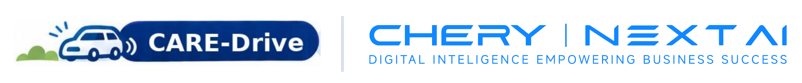
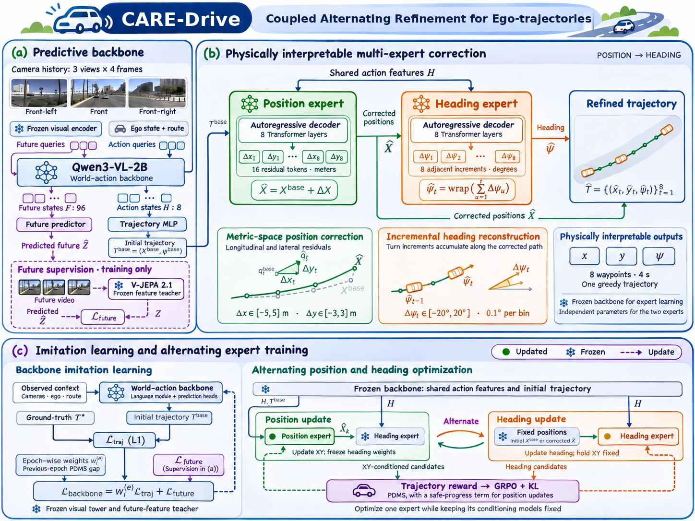
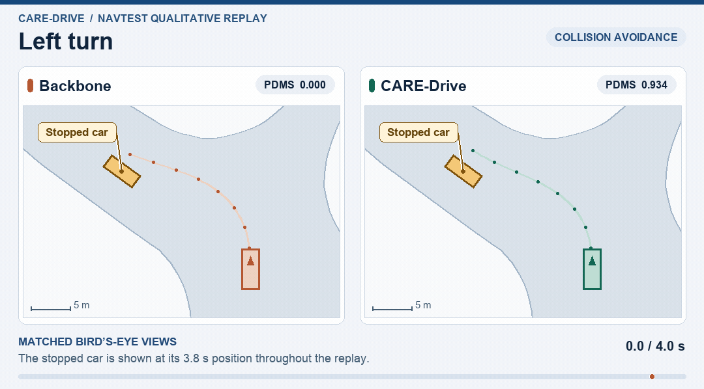
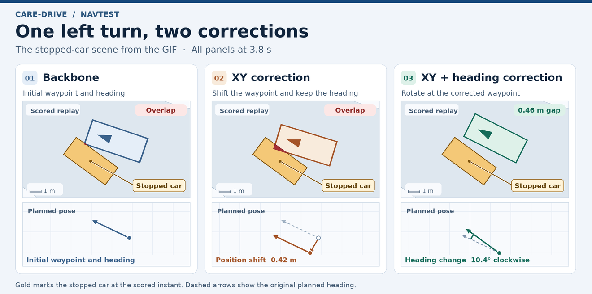
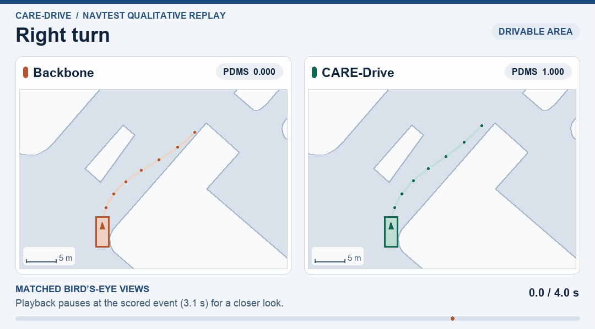
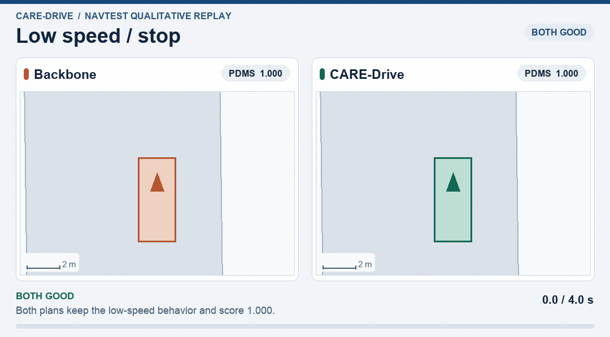

<p align="center">
  
</p>

<h1 align="center">CARE-Drive: Coupled Alternating Refinement for Ego-trajectories</h1>

<p align="center">
  <a href="https://github.com/chery-nextai">Xiao Ma</a><sup>*</sup>, <a href="https://github.com/chery-nextai">Yijun Chen</a><sup>*</sup>, <a href="https://github.com/chery-nextai">Zhiquan Hu</a>, <a href="https://github.com/chery-nextai">Jicheng Zhao</a>, <a href="https://github.com/chery-nextai">Yuming Li</a><sup>†</sup>, <a href="https://github.com/chery-nextai">Chuang Dai</a>
</p>

<p align="center">NEXTAI Research Institute, Chery Group.</p>

<p align="center"><sub>* Equal contribution. † Corresponding author.</sub></p>

## Introduction

<p align="center">
  
</p>

Vision–language–action (VLA) models bring multimodal understanding and world knowledge to end-to-end autonomous driving. To further improve the quality of predicted trajectories, existing studies introduce candidate refinement, residual denoising, and token correction. However, these methods typically focus on unified refinement of the entire trajectory, paying limited attention to the distinct physical quantities and their interactions. We further investigate physical specialization and coordination in trajectory refinement, centering on position and heading for simpler and more intuitive correction modeling. To this end, we propose CARE-Drive (Coupled Alternating Refinement for Ego-trajectories), which decomposes trajectory refinement into waypoint residual correction and position-conditioned heading generation. Through imitation learning and a future-token auxiliary task, the backbone provides predictive representations and a base trajectory. The position expert predicts bounded metric waypoint residuals, while the heading expert reconstructs vehicle orientation from adjacent angular increments conditioned on the corrected path. With the backbone frozen, the two experts are optimized alternately through supervised initialization and reinforcement fine-tuning. This design simplifies refinement through clear physical specialization while preserving conditional coupling during prediction and optimization. On NAVSIM v1, CARE-Drive achieves 88.8 PDMS, improving by 2.4 points over the unrefined base trajectories generated by the same backbone. Ablation studies further support the effectiveness of specialized experts and staged training.

## 🎬 Qualitative demonstrations

### Left turn around a stopped car

At 3.8 s in the NAVSIM replay, the backbone overlaps the stopped car. CARE-Drive clears it by 0.46 m.



The three panels below show the scored replay and planned pose for the same scene, from the backbone through position and heading correction.



### Right turn at the drivable-area boundary

At 3.1 s, one corner of the backbone vehicle is 7.4 cm outside the drivable area. The corresponding CARE-Drive corner is 69.5 cm inside.



<details>
<summary>More examples</summary>

### Low-speed stop

Both plans preserve the low-speed stopping behavior and score 1.000 PDMS in this scene.



</details>

## Usage

### 1. Dataset and pretrained models

CARE-Drive uses **NAVSIM v1**, with OpenScene/nuPlan driving logs, camera images, and nuPlan maps. Download the data using the [NAVSIM v1 instructions](https://github.com/autonomousvision/navsim/blob/v1.1/docs/install.md) and use the official **navtrain / navtest** scene filters. Each input contains four historical frames from the front, left, and right cameras, ego pose history, velocity, acceleration, and a navigation command. The output is eight `(x, y, heading)` poses over four seconds, in the current ego rear-axle frame; positions use meters and headings use radians.

The backbone starts from [Qwen3-VL-2B-Instruct](https://huggingface.co/Qwen/Qwen3-VL-2B-Instruct). Backbone training also uses the **V-JEPA2.1 ViT-G/16, 384 px** teacher from the [official V-JEPA repository](https://github.com/facebookresearch/vjepa2), applied to eight future front-camera images. Future images and teacher features are training targets; inference uses historical observations.

Arrange your local data as follows and set `CARE_DRIVE_DATA` to its absolute path:

```text
data/
├── maps/
├── navsim_logs/{trainval,test}/
├── sensor_blobs/{trainval,test}/
├── metric_cache/{navtrain,navtest}/
├── models/
│   ├── Qwen3-VL-2B-Instruct/
│   └── vjepa2_1_vitg384.pt
├── manifests/
└── cache/
```

Data, maps, pretrained weights, and trained CARE-Drive checkpoints are downloaded or generated separately. See [data preparation](docs/data.md) for metric caches, manifest export, and the distinction between the official splits and the paper's filtered training cohort.

### 2. Install the environment

Use Linux and Python 3.11. Install the PyTorch build appropriate for your accelerator first, including the matching `torchvision`; Ascend users also need matching `torch-npu` and CANN installations. Then install CARE-Drive:

```bash
git clone https://github.com/marshal12138/CARE-Drive.git
cd CARE-Drive
python -m venv --system-site-packages .venv
source .venv/bin/activate
python -m pip install -e .
```

The code uses Transformers **4.57.6**, FP32 expert training, and BF16 backbone forward passes. The paper experiments ran on Ascend NPUs. CUDA device support is included, but full CUDA training has not been validated in this release. CPU is suitable for the small unit tests.

Install NAVSIM v1 and the nuPlan devkit using the version-aware instructions in [environment setup](docs/environment.md); NAVSIM's older default dependency pins should not replace the required Qwen3-VL runtime. Clone V-JEPA2.1 into `third_party/vjepa2` for teacher-feature generation. Edit [configs/care_drive.yaml](configs/care_drive.yaml) to set `device`, model paths, data paths, and the output directory.

```bash
export CARE_DRIVE_DATA=/absolute/path/to/data
export NUPLAN_MAP_VERSION=nuplan-maps-v1.0
export NUPLAN_MAPS_ROOT="$CARE_DRIVE_DATA/maps"
python -m unittest discover -s tests -v
```

### 3. Training

The training chain is defined in [configs/expert_stages.json](configs/expert_stages.json). The effective batch size is 128; each stage runs for five epochs. Choose a device count and microbatch that fit your hardware while preserving the effective batch size.

| Stage | Trainable component | Objective / conditioning |
| --- | --- | --- |
| A0 | Predictive backbone | Trajectory L1 + future-feature supervision; previous-epoch PDMS sample weights |
| B1 | Heading expert | Supervised adjacent heading increments, conditioned on base positions |
| B2 → B3 | Heading expert | Two GRPO stages with official PDMS |
| C1 | Position expert | Supervised bounded XY residuals |
| C2 | Position expert | GRPO with official PDMS; frozen B3 generates each candidate's headings |
| C3 | Position expert | GRPO with the safety-gated progress bonus; B3 remains frozen |
| D1 | Heading expert | GRPO adaptation to frozen C3-corrected positions |

First export the training manifest and build the teacher cache as described in [data preparation](docs/data.md). Formal model training and batch inference require a measured performance report for the selected workload and hardware, supplied through `CARE_DRIVE_PERFORMANCE_PREFLIGHT`; [performance setup](docs/performance.md) describes the report and bounded preparation runs. Use a separate report for each stage. `--probe-steps 3` is a bounded diagnostic run and saves under `probe/`; its checkpoint is not a completed training stage.

Train the backbone:

```bash
export CARE_DRIVE_PERFORMANCE_PREFLIGHT=/absolute/path/to/performance/A0.json
torchrun --standalone --nproc_per_node=8 -m care_drive.train backbone \
  --config configs/care_drive.yaml
```

Next, extract the frozen backbone features used by every expert stage:

```bash
export CARE_DRIVE_PERFORMANCE_PREFLIGHT=/absolute/path/to/performance/features.json
python -m care_drive.prepare cache features \
  --config configs/care_drive.yaml \
  --manifest "$CARE_DRIVE_DATA/manifests/navtrain.jsonl" \
  --sensor-root "$CARE_DRIVE_DATA/sensor_blobs/trainval" \
  --backbone runs/care-drive/A0-DYNAMIC-L1/epoch_005.pt \
  --output "$CARE_DRIVE_DATA/cache/expert_train.pt"
```

Run the expert stages in order. Each stage automatically loads its declared predecessor and frozen conditioning expert from the output directory:

```bash
for stage in B1-H-SFT B2-H-GRPO1 B3-H-GRPO2 C1-XY-SFT C2-XY-P01 C3-XY-EP1 D1-H-ADAPT; do
  export CARE_DRIVE_PERFORMANCE_PREFLIGHT="/absolute/path/to/performance/${stage}.json"
  torchrun --standalone --nproc_per_node=8 -m care_drive.train expert \
    --config configs/care_drive.yaml --stage "$stage" || exit 1
done
```

GRPO and dynamic backbone weighting use **official NAVSIM v1 CPU scoring** in this portable implementation. Metric caches are required for scored scenes. The CPU scorer preserves the benchmark protocol; its throughput differs from the original accelerator scoring implementation.

### 4. Inference and evaluation

Use the trained A0 backbone, C3 position expert, and D1 heading expert. Export an observation-only navtest manifest using [data preparation](docs/data.md), then run greedy decoding:

```bash
export CARE_DRIVE_PERFORMANCE_PREFLIGHT=/absolute/path/to/performance/inference.json
python -m care_drive.infer \
  --config configs/care_drive.yaml \
  --manifest "$CARE_DRIVE_DATA/manifests/navtest.jsonl" \
  --sensor-root "$CARE_DRIVE_DATA/sensor_blobs/test" \
  --backbone runs/care-drive/A0-DYNAMIC-L1/epoch_005.pt \
  --position runs/care-drive/C3-XY-EP1/epoch_005.pt \
  --heading runs/care-drive/D1-H-ADAPT/epoch_005.pt \
  --batch-size 1 --output runs/care-drive/navtest_predictions.jsonl
```

Each output JSONL row contains a `sample_id` and an `8 × 3` trajectory. For multi-device inference, replace `python` with `torchrun --standalone --nproc_per_node=N`; outputs are written as `navtest_predictions.rankXXX.jsonl`.

Evaluate predictions against the official metric caches attached to the manifest:

```bash
python -m care_drive.evaluate \
  --manifest "$CARE_DRIVE_DATA/manifests/navtest.jsonl" \
  --predictions runs/care-drive/navtest_predictions.jsonl \
  --output runs/care-drive/navtest_metrics.json
```

For distributed output, pass all rank files after `--predictions`. Evaluation checks exact scene coverage and reports both normalized metrics and PDMS on the 0–100 scale.

The abstract reports the paper's measured result. This portable release has small CPU correctness tests; full-data retraining and full benchmark validation of these new entry points have not been completed. See [release validation](docs/validation.md) for the tested scope and checkpoint requirements.
